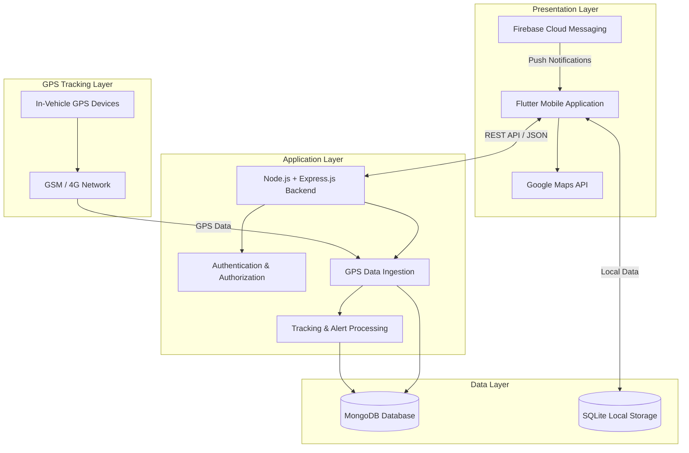

# CecilGo

### Real-Time Mobile-Based Vehicle Location Tracking and Monitoring System

<p align="center">
  
  
  
  
  
  
  
</p>

<p align="center">
  
  
  
</p>

> A dedicated GPS-powered fleet tracking and monitoring solution designed for Cecilyan Tea Factory, Sri Lanka.

---

## Table of Contents

- [Project Overview](#project-overview)
- [Problem Statement](#problem-statement)
- [Project Objectives](#project-objectives)
- [Core Features](#core-features)
- [User Roles](#user-roles)
- [System Modules](#system-modules)
- [Technology Stack](#technology-stack)
- [System Architecture](#system-architecture)
- [GPS Tracking Workflow](#gps-tracking-workflow)
- [Security and Privacy](#security-and-privacy)
- [Non-Functional Requirements](#non-functional-requirements)
- [Proposed Repository Structure](#proposed-repository-structure)
- [Development Methodology](#development-methodology)
- [Development Roadmap](#development-roadmap)
- [Future Enhancements](#future-enhancements)
- [Academic and Industry Context](#academic-and-industry-context)
- [Team](#team)
- [License](#license)

---

## Project Overview

**CecilGo** is a real-time, mobile-based vehicle location tracking and monitoring system proposed to improve fleet management operations at **Cecilyan Tea Factory, Sri Lanka**.

The system aims to provide factory management with centralized visibility and control over vehicle operations through dedicated GPS tracking hardware, a mobile application, and a backend management platform.

By integrating GPS technology, location-based services, and real-time monitoring capabilities, CecilGo is designed to help management monitor vehicle movements, identify route deviations, detect excessive idling, review historical journeys, and generate operational reports.

The solution consists of two primary application areas:
- **Manager Module**: Provides vehicle monitoring, live location tracking, route history, alerts, and reporting facilities.
- **Admin Module**: Provides centralized management of user accounts, vehicles, drivers, GPS devices, and system configurations.

CecilGo is being developed as an undergraduate Information Systems community project to address an identified operational requirement at Cecilyan Tea Factory.

---

## Problem Statement

Traditional vehicle management practices can make it difficult to maintain continuous visibility over fleet operations.

The identified challenges include:
- Limited visibility of vehicle locations.
- Difficulty identifying unauthorized vehicle usage.
- Delayed identification of route deviations.
- Lack of centralized vehicle movement records.
- Difficulty monitoring excessive vehicle idling.
- Repeated communication with drivers to determine vehicle locations.
- Limited access to historical tracking information for operational analysis.

CecilGo proposes a centralized digital solution to address these challenges through real-time GPS tracking, monitoring, notifications, and reporting.

---

## Project Objectives

The primary objective is to develop a reliable, secure, and user-friendly mobile-based vehicle tracking and monitoring system for Cecilyan Tea Factory.

Key objectives include:
- **Real-Time Vehicle Tracking**: Display the current locations of factory vehicles on an interactive map.
- **GPS-Based Monitoring**: Monitor vehicle movement, route adherence, speed, and stoppage patterns.
- **Route History and Playback**: Store historical location data and allow managers to review previous journeys.
- **Idle-Time Detection**: Identify excessive vehicle idling using configurable thresholds.
- **Route Deviation Detection**: Identify movements outside approved routes and support unauthorized-trip monitoring.
- **Vehicle and Driver Management**: Maintain centralized vehicle and driver information, including assignment histories.
- **Reporting and Analytics**: Generate daily, weekly, and on-demand fleet reports.
- **Mobile Accessibility**: Allow authorized users to monitor fleet operations through mobile devices.
- **Hardware Integration**: Integrate dedicated in-vehicle GPS tracking devices.
- **Security and Privacy**: Protect location information through authentication, authorization, encryption, and responsible tracking practices.

---

## Core Features

| Feature | Description |
| :--- | :--- |
| **Real-Time GPS Tracking** | Monitor multiple factory vehicles through an interactive map. |
| **Live Vehicle Monitoring** | Display vehicle positions, registration details, driver information, and last update times. |
| **Route Deviation Detection** | Identify vehicle movements outside approved routes. |
| **Idle-Time Detection** | Identify excessive vehicle stoppages using configurable thresholds. |
| **Route History and Playback** | Review and replay historical vehicle journeys. |
| **Trip Information** | Display trip start time, end time, distance, and stoppage information. |
| **Driver Management** | Maintain driver profiles, assignments, and performance information. |
| **Vehicle Management** | Register vehicles, update details, and manage vehicle status. |
| **Alerts and Notifications** | Notify managers about critical tracking events and system activities. |
| **Fleet Reports** | Generate daily, weekly, and customized operational reports. |
| **Data Export** | Support CSV and PDF report exports. |
| **Administration** | Manage users, roles, GPS devices, settings, and audit records. |

---

## User Roles

CecilGo defines three primary user roles with role-based access control:

| User Role | Responsibilities |
| :--- | :--- |
| **Admin** | Manage user accounts, vehicles, drivers, GPS devices, system settings, and permissions. |
| **Manager** | Monitor vehicles, review routes, manage assignments, receive alerts, and generate reports. |
| **Viewer** | Access permitted vehicle monitoring information according to assigned permissions. |

> **Important**: Drivers do not directly use the CecilGo mobile application. Driver information is maintained for vehicle assignment, operational accountability, and performance monitoring.

---

## System Modules

The system is organized into eight major modules:

### M1 – User Authentication and Authorization
- User registration and secure login.
- JWT-based session management.
- Password hashing using bcrypt.
- Role-based access control.
- Password reset functionality.
- Account lockout after configurable failed login attempts.
- User account management.

### M2 – Vehicle Management
- Register new vehicles.
- Update vehicle information.
- Manage vehicle registration numbers and details.
- Search and filter vehicle records.
- Update vehicle status: Active, Inactive, or Maintenance.
- Assign vehicles to drivers.
- Maintain vehicle assignment history.
- Manage vehicle-related documents.

### M3 – Vehicle and Driver Assignment
- Create and maintain driver profiles.
- Store driving licence and contact information.
- Assign drivers to vehicles for specific shifts.
- Maintain driver assignment history.
- Track driver status.
- Support driver performance evaluation.

### M4 – GPS Data Ingestion and Tracking
- Receive GPS data from dedicated tracking devices.
- Process latitude, longitude, speed, and timestamps.
- Validate incoming location information.
- Authenticate tracking devices using unique IMEI numbers.
- Store GPS records for historical analysis.
- Support configurable transmission intervals.
- Handle temporary network interruptions and data transmission retries.
- Support HTTP/HTTPS and MQTT communication.

### M5 – Live Map Tracking
- Display multiple active vehicles on an interactive map.
- Update vehicle positions using incoming GPS data.
- Display vehicle registration numbers and driver details.
- Search and filter vehicles.
- View the last known locations of inactive vehicles.
- Support map navigation, zooming, and vehicle selection.
- Display relevant road and traffic information where supported.

### M6 – Route History and Playback
- Store historical GPS location records.
- Select vehicles and date ranges.
- Visualize recorded journeys on a map.
- Replay historical vehicle movements.
- Display trip start time, end time, and distance.
- Highlight stopping points and idle periods.
- Compare multiple trips.
- Export route information as CSV or PDF.

### M7 – Reporting and Analytics
- Generate daily and weekly fleet reports.
- Generate idle-time reports.
- Generate driver performance reports.
- Filter reports by vehicle, driver, and date range.
- Display fleet performance information.
- Export reports in CSV and PDF formats.
- Support fuel usage estimates based on available information.
- Support scheduled email reports.

### M8 – Administration and Settings
- Manage user accounts and permissions.
- Configure GPS update intervals.
- Configure idle-time thresholds.
- Manage data retention settings.
- Maintain user activity and audit logs.
- Manage API keys and integrations.
- Configure notification preferences.
- Support data backup and restoration.
- Monitor system health and performance.

---

## Technology Stack

The following technologies are specified in the project proposal:

| Technology | Purpose |
| :--- | :--- |
| **Flutter** | Cross-platform mobile application development |
| **Dart** | Mobile application programming language |
| **Node.js** | Backend runtime environment |
| **Express.js** | REST API development |
| **MongoDB** | Database management and GPS data storage |
| **Google Maps API** | Map visualization, geocoding, and location services |
| **Firebase Cloud Messaging** | Push notifications |
| **SQLite** | Local mobile data storage |
| **JWT** | Authentication and session management |
| **bcrypt** | Password hashing |
| **HTTPS/TLS** | Secure communication |
| **MQTT** | GPS data communication where supported |
| **Git & GitHub** | Version control and collaboration |
| **Postman** | API development and testing |
| **Swagger/OpenAPI** | API documentation |

---

## System Architecture

CecilGo follows a proposed three-tier architecture consisting of the presentation layer, application layer, and data layer, supported by GPS hardware integration.



### Architecture Components
- **GPS Hardware Layer**: Collects vehicle location, speed, timestamp, and ignition information.
- **Communication Layer**: Transmits tracking information through GSM/GPRS/4G networks.
- **Backend Layer**: Processes API requests, authentication, GPS ingestion, and monitoring logic.
- **Database Layer**: Stores user, vehicle, driver, trip, device, and location records.
- **Presentation Layer**: Provides mobile access to tracking and fleet management functionality.
- **Integration Layer**: Connects the mobile application with mapping and notification services.

---

## GPS Tracking Workflow

The proposed tracking workflow operates as follows:
1. A dedicated GPS tracking device is installed in a factory vehicle.
2. The device collects location information, speed, timestamp, and ignition status.
3. GPS data is transmitted to the backend through a mobile network.
4. The backend validates incoming information and authenticates the tracking device.
5. Valid location records are stored in MongoDB.
6. The mobile application retrieves the latest vehicle information through backend APIs.
7. Vehicle locations are visualized on Google Maps.
8. The monitoring system processes relevant tracking events, including route deviations and excessive idling.
9. Managers receive notifications and can access historical routes and reports.

---

## Security and Privacy

CecilGo incorporates security and privacy considerations into its proposed system design.

Key requirements include:
- Secure user authentication.
- Role-based access control for Admin, Manager, and Viewer roles.
- Password hashing using bcrypt.
- JWT-based session management.
- HTTPS/TLS communication.
- Authentication of GPS devices using unique IMEI numbers.
- Protection of sensitive vehicle and location information.
- Regular database backups.
- Audit logging of important user activities.
- Rate limiting and network security controls.
- Driver awareness and consent before tracking implementation.

> **Privacy principle**: Vehicle tracking is intended for factory operations and business purposes. Tracking is restricted to relevant working periods, with the proposed hardware configured to activate tracking according to vehicle ignition status.

---

## Non-Functional Requirements

The proposal defines the following important quality requirements:

| Category | Proposed Requirement |
| :--- | :--- |
| **Location Update** | Display location updates within 10–30 seconds of receiving GPS data. |
| **Map Performance** | Load the live map within 5 seconds on a standard mobile connection. |
| **Initial Scalability** | Support at least 50 vehicles and 10 concurrent users. |
| **Reliability** | Minimize downtime during factory working hours. |
| **Security** | Use secure authentication, encryption, and role-based permissions. |
| **Compatibility** | Support Android and iOS mobile devices. |
| **Usability** | Provide an intuitive interface requiring minimal user training. |
| **Maintainability** | Use a modular architecture for future improvements. |
| **Portability** | Support deployment on cloud or local servers. |
| **Accuracy** | Validate GPS records before storing and displaying tracking information. |

> *Note: These are proposed targets and requirements, not verified performance results.*

---

## Proposed Repository Structure

The repository may follow this structure as implementation progresses:

```text
CecilGo/
├── mobile/
│   ├── lib/
│   │   ├── models/
│   │   ├── screens/
│   │   ├── widgets/
│   │   ├── services/
│   │   ├── providers/
│   │   └── utils/
│   ├── assets/
│   └── test/
├── backend/
│   ├── src/
│   │   ├── config/
│   │   ├── controllers/
│   │   ├── middleware/
│   │   ├── models/
│   │   ├── routes/
│   │   ├── services/
│   │   └── utils/
│   ├── tests/
│   └── server.js
├── docs/
│   ├── proposal/
│   ├── diagrams/
│   ├── requirements/
│   └── api/
├── .gitignore
└── README.md
```

*This is an illustrative structure and can be adjusted to match the actual repository.*

---

## Development Methodology

CecilGo follows the **Agile Software Development Methodology**.

Development is planned through iterative sprints, continuous testing, and feedback from factory stakeholders.

The development process includes:
- Requirement Gathering and Analysis
- System Design and Architecture
- Iterative Development
- Feature Integration
- Testing and Quality Assurance
- Deployment and User Training
- Maintenance and Continuous Improvement
- Technical Documentation

The Agile approach allows the development team to refine system functionality based on stakeholder feedback and practical testing.

---

## Development Roadmap

1. Requirements gathering and analysis
2. Use case, ER, and class diagram preparation
3. Database design and system architecture
4. Flutter mobile application setup
5. Node.js and Express.js backend setup
6. User authentication and authorization
7. Vehicle management
8. Driver management and assignment
9. GPS hardware integration
10. GPS data ingestion and validation
11. Real-time vehicle tracking
12. Interactive map integration
13. Route history and playback
14. Idle-time and route deviation monitoring
15. Alerts and push notifications
16. Reporting and analytics
17. Administration and settings
18. Integration and system testing
19. Security and performance testing
20. User acceptance testing
21. Deployment and documentation

---

## Future Enhancements

Potential future extensions identified in the project proposal include:
- Advanced route optimization.
- Fuel consumption analytics.
- Predictive vehicle maintenance.
- Expanded fleet performance analytics.
- Integration with additional fleet management services.
- Support for larger vehicle fleets.

---

## Academic and Industry Context

| Detail | Information |
| :--- | :--- |
| **Project Name** | CecilGo |
| **Full Title** | Real-Time Mobile-Based Vehicle Location Tracking and Monitoring System |
| **Module** | IS5109 – IS Project for Community |
| **Group** | Group No. 15 |
| **Department** | Department of Computing and Information Systems |
| **Faculty** | Faculty of Computing |
| **University** | Sabaragamuwa University of Sri Lanka |
| **Industry Partner** | Cecilyan Tea Factory, Sri Lanka |
| **Project Period** | October 2026 onwards |
| **Methodology** | Agile |
| **Project Status** | In Development |

---

## Team

Developed by **Group 15** – Undergraduate Information Systems Students, Sabaragamuwa University of Sri Lanka.

| Index Number | Team Member |
| :--- | :--- |
| 22FIS0571 | M.A.F. Zamha |
| 22FIS0573 | T. Asvinitha |
| 22FIS0574 | T. Gopan |
| 22FIS0575 | T. Mathusa |
| 22FIS0577 | K. Yukkeshan |
| 22FIS0582 | S. Vithuckshana |

### Acknowledgement

We gratefully acknowledge **Cecilyan Tea Factory** for providing the opportunity to understand its vehicle management operations and identify a practical problem that can be addressed through information technology.

We also extend our appreciation to the academic staff and project supervisor at the Faculty of Computing, Sabaragamuwa University of Sri Lanka, for their guidance and support.

---

## License

The licensing and distribution terms of CecilGo will be determined by the project team in accordance with the academic and industry requirements.

---

<p align="center">
  <strong>CecilGo</strong><br>
  <em>Real-Time Tracking. Smarter Fleet Management. Better Operational Visibility.</em><br><br>
  An Information Systems Community Project<br>
  <strong>Sabaragamuwa University of Sri Lanka</strong>
</p>

